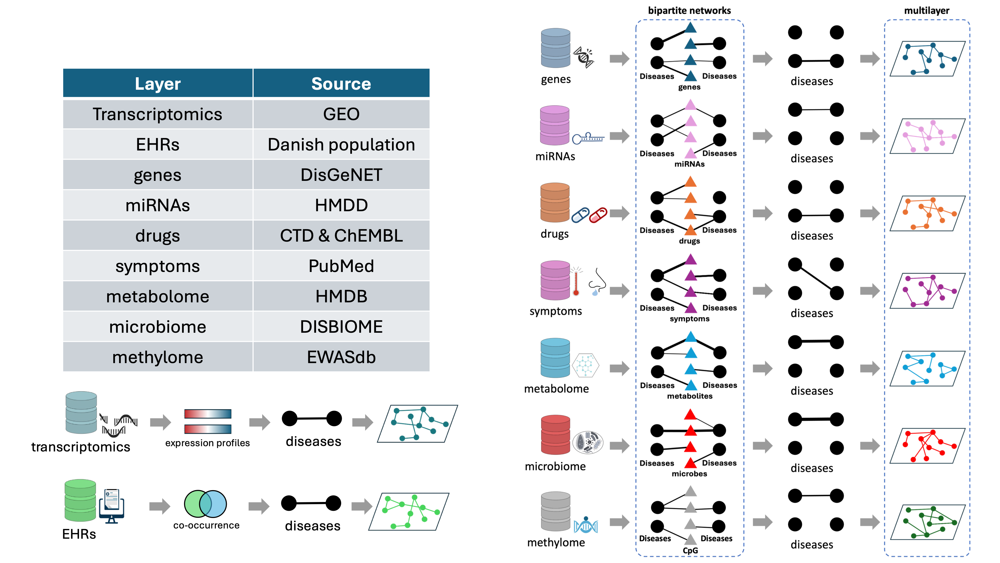
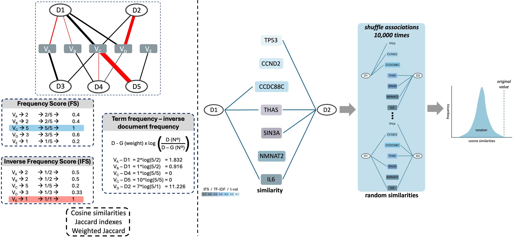

# Human Disease Multilayer Network (HDML)

Pipeline for building a **disease multilayer network** that integrates multiple sources of molecular and clinical information to study comorbidity relationships. Developed at the **Barcelona Supercomputing Center (BSC)** in the context of the [COMMUTE project](https://www.commute-project.eu/).

The goal is to connect diseases through shared molecular features — genes, miRNAs, drugs, symptoms, metabolites, methylation marks, microbiome, and transcriptomics — and to use the resulting multilayer structure to understand the biological basis of comorbidities and explore opportunities for drug repositioning.



---

## Overview

Co-occurrence of diseases decreases patient quality of life, complicates treatment choices, and increases mortality. Analyses of electronic health records present a complex scenario of comorbidity relationships that vary by age, sex, and cohort under study. Integrating different sources of molecular information using AI methods is a promising approach for studying and treating comorbidities, including potential drug repositioning [(Sanchez-Valle et al., 2023)](https://www.cell.com/action/showPdf?pii=S0168-9525%2823%2900134-8).

In all layers (except the transcriptome), bipartite networks connect diseases to molecular or clinical variables through different similarity weights. Disease-disease similarity is then derived from these bipartite associations.

---

## Dictionary

Disease names, MeSH terms, and DOID identifiers are translated into ICD-10 codes using the Unified Medical Language System (UMLS), followed by manual curation. The resulting dictionary (`DiseaseName_ICD10_dictionary.txt`) provides disease name–ICD-10 associations, including disease category and a colour palette for visualisation.

---

## Pipeline Scripts

The pipeline is structured in five numbered R scripts, each executed from the command line with a step argument:

```bash
Rscript <script.R> <step> [additional arguments]
```

### `00_Preprocessing.R`

General preprocessing utilities, including:

- **`Get_disease_mesh_terms`** — Parses the MeSH XML descriptor file (`desc2025.xml`) and extracts all disease-related terms (tree numbers starting with `C`).
- **`Get_entire_list_of_papers_describing_diseases`** — Collects all PubMed IDs associated with disease and symptom MeSH terms for downstream co-occurrence analyses.
- **`Paper_year_publication_into_single_table`** — Extracts year, country, and journal information from PubMed JSON records for diseases, symptoms, and COVID-19.
- **`transcriptomicsandepidemiology`** — Integrates precomputed transcriptomics (cosine similarities and FDR) and epidemiology (adjusted relative risk from Danish registry data) layers into the similarity framework.
- **`AlphaTom`** — Generates a term dictionary for the COMMUTE WP2 integration.

### `01_generate_intralayers_icd10.R`

Generates the within-layer (intralayer) disease–disease similarity networks for each omic source. For each layer:

- Translates disease names to ICD-10 codes.
- Assigns weights to molecular variables based on their frequency of association across diseases: frequency score (fs), inverse frequency score (ifs), and TF-IDF where applicable.
- Computes cosine similarities, Jaccard indexes, and weighted Jaccard indexes between all pairs of diseases.
- Estimates p-values through randomisations and applies Bonferroni correction for multiple testing.

### `02_generate_interlayers_icd10.R`

Generates the between-layer (interlayer) connections of the multilayer network, linking disease nodes across the different omic layers.

### `03_analyze_networks.R`

Analyses the properties of the individual and combined disease networks, including descriptive statistics, network topology, and comparisons across layers.

### `04_MultiplexAnalysis.R`

Constructs and analyses the full disease multilayer network using Random Walk with Restart (RWR) via [RWRtoolkit](https://github.com/dkainer/RWRtoolkit). Key steps include:

- **`create_directories`** — Sets up the required output directory structure.
- **`prepare_layers`** — Formats individual networks and builds single-layer multiplex objects.
- **`multiplex_analysis_ctd`** / **`multiplex_analysis_chembl`** / **`multiplex_analysis_chemblall`** — Runs RWR on the multiplex network using different drug source configurations (CTD, ChEMBL).
- **`CmmD`** — Performs community detection using [CmmD](https://github.com/alberto-valdeolivas/CmmD) across resolution parameters, with bootstrap-based hierarchical clustering (pvclust) to assess cluster stability.
- **`get_shortest_paths`** — Computes shortest paths between diseases of interest (e.g. COVID-19 [U07] and Alzheimer's disease [G30]) within each layer.
- **`calculate_similarities_between_diseases`** — Derives cosine similarities between diseases from the RWR diffusion profiles.

---

## Data Sources

| Layer | Source | Notes |
|---|---|---|
| Gene | [DisGeNET](https://www.disgenet.org) | Curated disease–gene associations |
| miRNA | [HMDD](https://www.cuilab.cn/hmdd) | Manually curated disease–miRNA associations |
| Drug (CTD) | [CTD](https://ctdbase.org) | Therapeutic associations only, no inferred |
| Drug (ChEMBL) | [ChEMBL](https://www.ebi.ac.uk/chembl/) | Therapeutic associations only, no inferred |
| Symptom | [Zhou et al., 2014](https://www.nature.com/articles/ncomms5212) | Disease–symptom co-occurrences in PubMed; updated 31/03/2025 by NLP4BIA (BSC) |
| Microbiome | [DISBIOME](https://disbiome.ugent.be/home) | Gut microbiome associations only |
| Methylome | [EWASdb](http://www.bioapp.org/ewasdb/) | 450K arrays; p < 1e-3 and p < 1e-7 thresholds |
| Metabolome | [HMDB](https://hmdb.ca) | Blood metabolite associations |
| Transcriptome | GEO (HG U133Plus2 arrays) | Cosine similarity of fold changes between diseases |
| Epidemiology | [Westergaard et al., 2019](https://www.nature.com/articles/s41467-019-08475-9) | Adjusted relative risk from Danish health registry |

---

## Validation: Overlap with Danish Comorbidity Data

To evaluate the biological relevance of each layer, disease–disease similarities from each omic source were compared against known comorbidities from the Danish population registry. The table below summarises, for the best-performing metric per layer, the number of significant similarities, known comorbidities covered, and the overlap between both — along with recall, precision, and a combined score.

| Layer | Weight | Metric | Similarities | Comorbidities | Overlap | p-value | Shared diseases | Recall (%) | Precision (%) | Score |
|---|---|---|---:|---:|---:|---:|---:|---:|---:|---:|
| Drug (CTD) | fs | Weighted Jaccard | 19,468 | 7,345 | 2,403 | < 0.001 | 569 | 32.72 | 12.34 | 403.76 |
| Drug (ChEMBL) | fs | Weighted Jaccard | 1,536 | 3,465 | 268 | < 0.001 | 351 | 7.73 | 17.45 | 134.89 |
| Drug (ChEMBL all) | fs | Weighted Jaccard | 27,711 | 6,841 | 2,328 | < 0.001 | 549 | 34.03 | 8.40 | 285.85 |
| Gene | fs | Weighted Jaccard | 12,455 | 7,473 | 1,523 | < 0.001 | 591 | 20.38 | 12.23 | 249.25 |
| Metabolome | fs | Weighted Jaccard | 578 | 726 | 100 | 0.007 | 137 | 13.77 | 17.30 | 238.22 |
| Methylome | ifs | Cosine similarity | 209 | 131 | 17 | 0.047 | 70 | 12.98 | 8.13 | 105.53 |
| Microbiome | fsd | Cosine similarity | 849 | 512 | 124 | 0.014 | 107 | 24.22 | 14.61 | 353.85 |
| miRNA | fs | Weighted Jaccard | 27,498 | 5,697 | 1,884 | 0.002 | 500 | 33.07 | 6.85 | 226.53 |
| Symptom (MK) | tfidf | Weighted Jaccard | 20,589 | 8,002 | 3,129 | < 0.001 | 671 | 39.10 | 15.20 | 594.32 |
| Symptom | fs | Cosine similarity | 161,563 | 7,606 | 6,803 | 0.014 | 645 | 89.44 | 4.21 | 376.54 |
| Transcriptome | fc | Cosine similarity | 1,665 | 177 | 98 | 0.001 | 84 | 55.37 | 5.89 | 326.13 |

**Recall**: % of known Danish comorbidities recovered by the layer. **Precision**: % of predicted similarities that correspond to known comorbidities. **Score**: recall × precision, used as a combined performance indicator.

---

## Disease Multilayer

In each layer, nodes represent diseases and edges represent similarities based on the respective molecular source. The disease categories with the largest representation are infectious diseases and neoplasms (ICD-10 chapters I and II). The symptom layer covers the highest number of diseases overall.



---

## Requirements

**R version:** ≥ 4.0 recommended

**R packages:**

```r
install.packages(c(
  "data.table", "igraph", "lsa", "dplyr", "ggplot2",
  "circlize", "e1071", "RColorBrewer", "VennDiagram",
  "tidyr", "tidyverse", "jsonlite", "xml2",
  "corrplot", "ggcorrplot", "dendextend", "forestplot",
  "ggpattern", "pvclust", "parallelDist", "gridExtra"
))

# Bioconductor
if (!require("BiocManager")) install.packages("BiocManager")
BiocManager::install("UpSetR")

# GitHub
devtools::install_github("alberto-valdeolivas/CmmD")
devtools::install_github("dkainer/RWRtoolkit")

# Cytoscape interface (optional, for visualisation)
BiocManager::install("RCy3")
```

---

## Author

**Jon Sanchez-Valle** — Barcelona Supercomputing Center (BSC)

Developed in the context of the [COMMUTE project](https://www.commute-project.eu/) (Deliverable 4.2).
